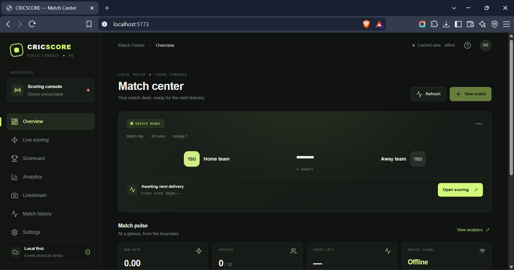
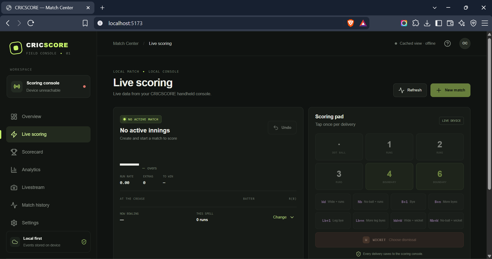
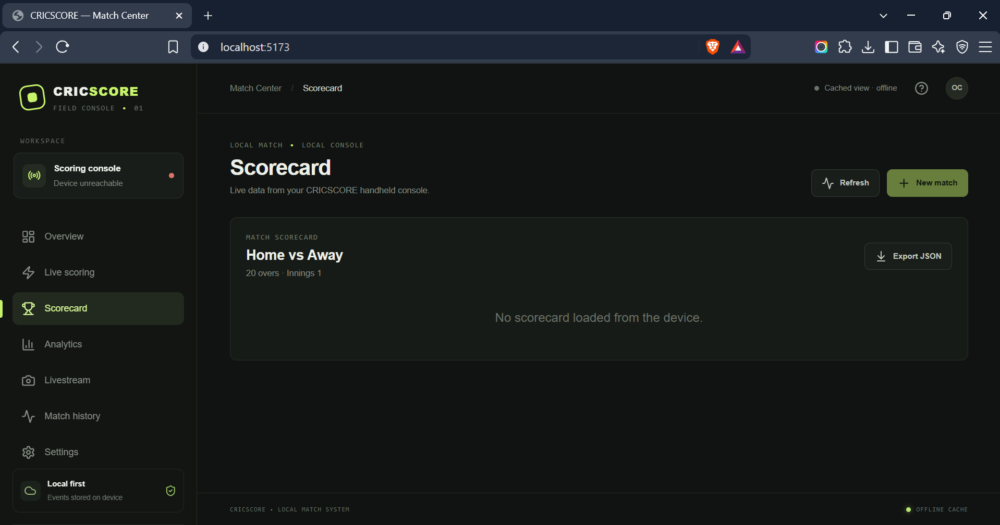
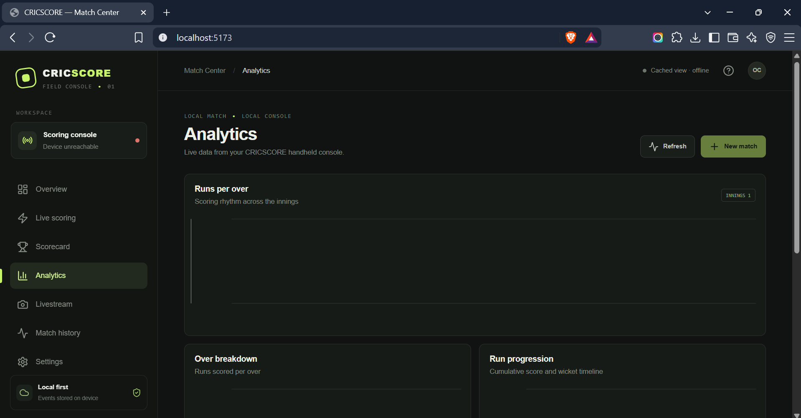
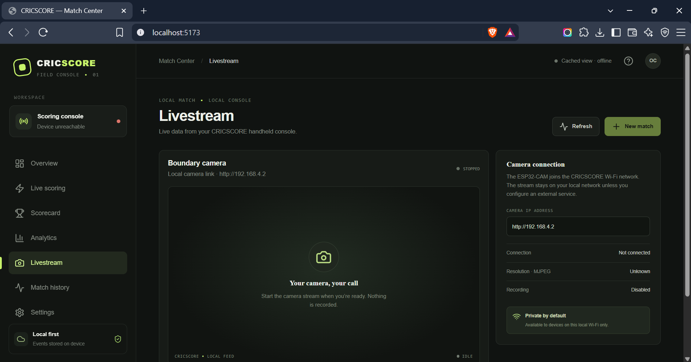
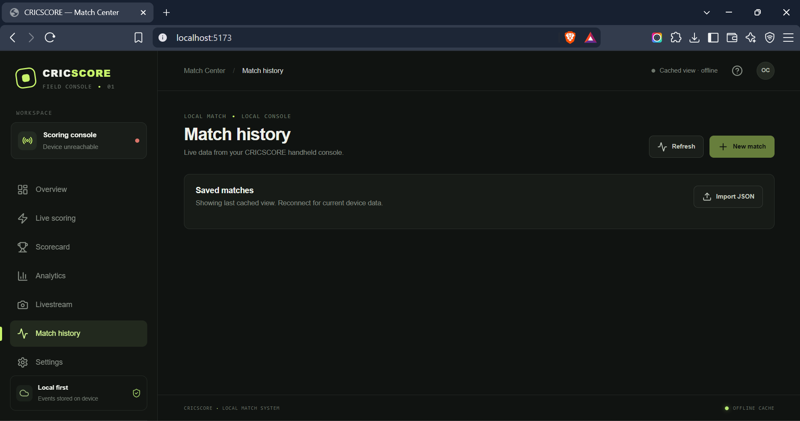
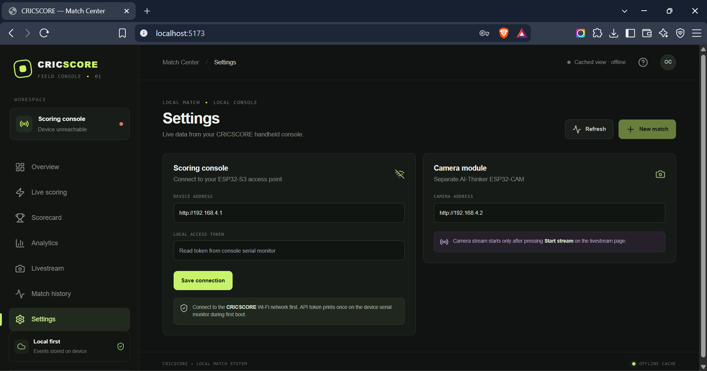

# CRICSCORE

CRICSCORE is an offline-first cricket scoring monorepo for an ESP32-S3 scoring console, a separate AI-Thinker ESP32-CAM, and a React companion website. The ESP32 is the intended source of truth; the web app uses the local HTTP API and caches the last loaded matches for read-only offline viewing.

## Repository map

- `firmware/main-controller/` — PlatformIO ESP32-S3 app, local access point, REST API and LittleFS storage.
- `firmware/camera-controller/` — separate AI-Thinker ESP32-CAM PlatformIO app, explicit start/stop and MJPEG endpoint.
- `website/` — React, TypeScript, Vite, Tailwind and Recharts interface. `npm run build` writes production assets to the main controller's `data/` folder for LittleFS upload.
- `docs/` — architecture, API, wiring, setup and validation notes.

## Quick start

1. Install Node.js 20+ and PlatformIO Core (VS Code PlatformIO extension is also supported).
2. From the repository root run `npm install`, then `npm run dev` for the desktop development app or `npm run build` for ESP32-served assets.
3. Set the selected display pins in a board-specific config header after confirming the TFT/touch module. No display GPIOs are guessed in the supplied configuration.
4. Build and upload `firmware/main-controller` to the ESP32-S3. Upload its filesystem image after the website build.
5. Connect to Wi-Fi `CRICSCORE` (password `cricscore123`) and open `http://192.168.4.1`. On the first boot, copy the local API token from the serial monitor into Settings.
6. Build and upload `firmware/camera-controller` to the AI-Thinker ESP32-CAM. It joins the main controller at `192.168.4.1`; its initial address is `192.168.4.2`. Stream stays stopped until Start is pressed.

See [setup](docs/setup.md), [architecture](docs/architecture.md), [API](docs/api.md), [wiring](docs/wiring.md), and [testing](docs/testing.md).

## Scoring engine checks

The deterministic, hardware-independent TypeScript event-replay tests live in `website/src/engine.test.ts`. Run `npm run test:engine` after dependency installation. `npm run build` also checks TypeScript types before bundling.

## Network and safety defaults

The AP password is the user-requested initial default and should be changed before public use. A random API token is generated on first boot, saved in LittleFS, and printed once to serial. The API is local-network only. Camera streaming is an explicit action; no recording feature exists. Cloud sync is not configured, and the UI does not claim it is.

